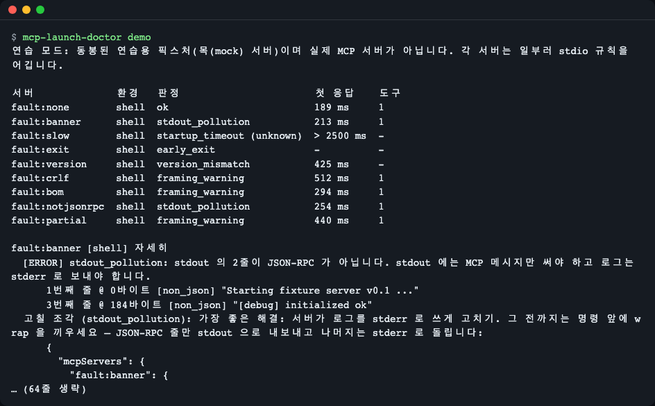
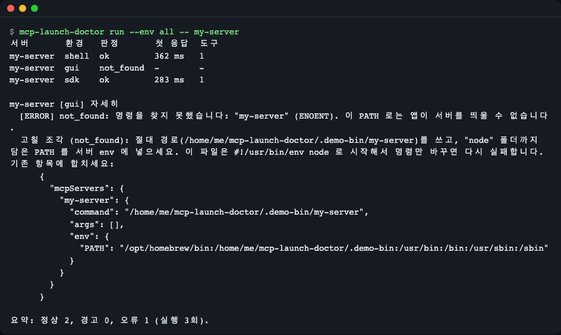
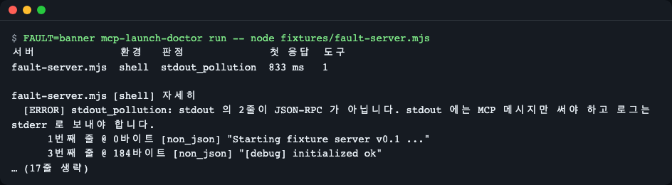
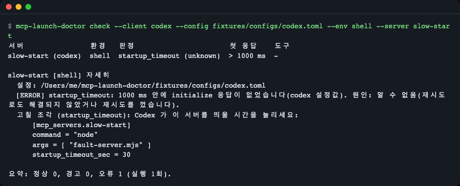
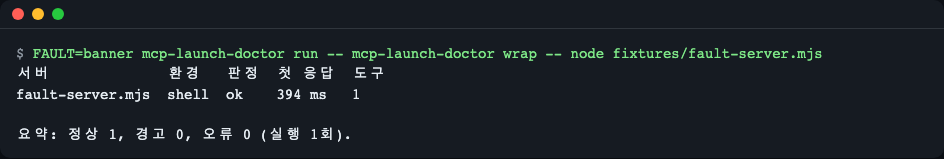
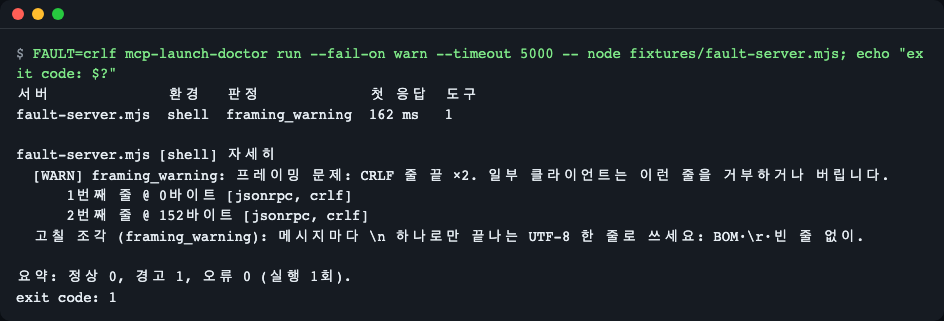
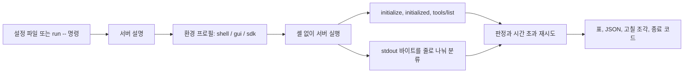

# mcp-launch-doctor

[English](README.md) | **한국어**

터미널에서는 되는데 앱에서는 "Server disconnected" 한 줄만 보이나요? `mcp-launch-doctor` 는 stdio MCP 서버를 Claude Desktop·Claude Code·Cursor·VS Code·Codex 가 띄우는 방식대로 실행하고 stdout 을 바이트 단위로 읽어, 왜 실패하는지와 그대로 붙여 넣을 설정 조각을 알려 줍니다.


*`mcp-launch-doctor demo` 는 동봉한 연습용(목) 서버 9개를 띄워 서버마다 판정 하나를 보여 줍니다.*

## 이런 분께

- MCP 서버를 앱에 넣었는데 터미널에서는 되고 앱 안에서만 연결이 끊기는 분.
- stdio MCP 서버를 만들면서 stdout 에 JSON-RPC 말고는 아무것도 안 나가는지 확인하고 싶은 분.
- 서버가 배너를 찍거나, 너무 늦게 시작하거나, CRLF·BOM 줄바꿈을 쓰면 CI 가 실패하게 하고 싶은 분.

## 설치

Node.js 22 이상이 필요합니다(`node --version`). 없다면 <https://nodejs.org> 에서 설치하거나 [nvm](https://github.com/nvm-sh/nvm)(`nvm install 22`)을 쓰세요. 최소 리눅스 이미지에서는 `git` 과 `npm` 도 필요합니다(Debian/Ubuntu: `apt-get install -y git npm`).

```bash
# 설치 없이 실행 (패키지가 npm 에 올라간 뒤)
npx mcp-launch-doctor --help

# 또는 레포에서
git clone https://github.com/LeeGyeongPil/mcp-launch-doctor
cd mcp-launch-doctor
npm ci          # 의존성 설치 + dist/ 빌드
npm start       # 빌드 후 연습용 데모 실행
```

clone 에서 짧은 `mcp-launch-doctor` 명령을 PATH 에 두려면 `npm link` 를 한 번 실행하세요(또는 `node dist/cli.js` 를 직접 호출). clone 안에서 `node dist/cli.js <명령>` 은 `npx mcp-launch-doctor <명령>` 과 결과가 같습니다. 예외는 하나, `stdout_pollution` 의 `wrap` 고칠 조각입니다. npx 로 실행하면 npx 캐시 폴더는 언제든 지워질 수 있으므로 조각이 `"command": "npx", "args": ["-y", "mcp-launch-doctor@0.2.0", "wrap", "--", …]`(방금 실행한 버전으로 고정)로 wrap 을 띄웁니다. clone 이나 전역 설치(`npm i -g mcp-launch-doctor`)로 실행하면 `node` 와 그 `dist/cli.js` 의 절대 경로를 씁니다.

아래 예와 스크린샷은 전역 설치한 것처럼 짧은 이름 `mcp-launch-doctor` 를 씁니다. 각 스크린샷은 바로 위 코드 블록의 명령을 그대로 실행한 화면입니다.

## 안전 안내

`check` 와 `run` 은 **설정에 적힌 명령을 앱과 똑같이 실행**합니다. 먼저 `--dry-run`(아무것도 실행하지 않음)으로 확인하고, `--server <이름>` 으로 범위를 좁히세요. 대화형 터미널에서 `check` 는 실행할 명령 목록을 보여 주고 한 번 확인을 받습니다(`--yes` 로 생략, CI 같은 비대화형 실행은 묻지 않음). 키처럼 보이는 값(`*_KEY`, `*_TOKEN`, `*_SECRET`, `*PASSWORD*`, `sk-…`, `Bearer …`)은 모든 출력에서 `***` 로 가려집니다. 명령 인자(`--api-key sk-…`, `--token …`)와 수정 예시도 포함하며, 예시에 `***` 가 보이면 기존 값을 그대로 쓰세요.

## 빠르게 시작하기

```bash
mcp-launch-doctor demo
```

이것은 **연습용 목(mock) 모드**입니다. 서버는 이 레포의 `fixtures/` 에 있는 가짜 MCP 서버이지만 진짜 자식 프로세스입니다 — 하나는 실제로 배너를 찍고, 하나는 실제로 늦게 응답하고, 하나는 실제로 종료 코드 3 으로 죽습니다. 도구는 여러분의 서버를 판정할 때와 같은 코드 경로로 판정합니다. (실제 서버 진단은 `npx` 가 처음 패키지를 내려받는 경우처럼 더 느릴 수 있습니다.)

출력의 첫 부분은 이렇습니다.

```
연습 모드: 동봉된 연습용 픽스처(목(mock) 서버)이며 실제 MCP 서버가 아닙니다. 각 서버는 일부러 stdio 규칙을 어깁니다.

서버              환경   판정                       첫 응답    도구
fault:none        shell  ok                         131 ms     1
fault:banner      shell  stdout_pollution           131 ms     1
fault:slow        shell  startup_timeout (unknown)  > 2500 ms  -
fault:exit        shell  early_exit                 -          -
fault:version     shell  version_mismatch           132 ms     -
fault:crlf        shell  framing_warning            117 ms     1
fault:bom         shell  framing_warning            116 ms     1
fault:notjsonrpc  shell  stdout_pollution           122 ms     1
fault:partial     shell  framing_warning            129 ms     1
```

(밀리초는 실행마다 다릅니다. 영어 화면은 `mcp-launch-doctor demo --lang en`.) 이제 내 앱의 서버를 진단합니다.

```bash
mcp-launch-doctor check                 # 찾을 수 있는 모든 클라이언트 설정
mcp-launch-doctor check --client codex  # 클라이언트 하나만
mcp-launch-doctor run -- node dist/index.js   # 설정 파일 없이 명령 하나
```

## 사용법

| 명령 | 하는 일 |
|---|---|
| `check [옵션]` | Claude Desktop·Claude Code·Cursor·VS Code·Codex 설정 파일을 읽어 stdio 서버를 하나씩 진단합니다(기본 환경 `gui`, `shell`). |
| `run [옵션] -- <명령> [인자…]` | 서버 명령 하나를 진단합니다(기본 `shell`). CI 에 편합니다. |
| `wrap -- <명령> [인자…]` | 서버를 실행하되 JSON-RPC 줄만 stdout 으로 내보내고 나머지는 stderr 로 보냅니다. |
| `demo` | 동봉한 목 서버로 하는 연습 실행. |

| 옵션 | 뜻 |
|---|---|
| `--client <이름>` | `claude-desktop`, `claude-code`, `cursor`, `vscode`, `codex` 또는 `all`. `run` 에서는 그 클라이언트의 제한 시간과 조각 형식을 고릅니다. |
| `--config <경로>` | 기본 위치 대신 이 파일을 읽습니다(`.toml` 은 Codex). |
| `--server <이름>` | 이 서버만. |
| `--env <프로필>` | `shell`, `gui`, `sdk`(쉼표로 여러 개) 또는 `all`. |
| `--timeout <ms>` | 모든 서버의 시작 제한 시간. 클라이언트별 값보다 우선. |
| `--no-retry` | 시간 초과 원인을 찾는 재시도를 끕니다. |
| `--dry-run` | 실행할 내용만 보여 주고 아무것도 실행하지 않습니다. |
| `--yes` | 실행 전 확인을 생략합니다(`check`). |
| `--json` | 기계가 읽는 출력(`schemaVersion: 1`). |
| `--fail-on <등급>` | `error`(기본), `warn`, `never`. |
| `--lang <언어>` | `en` 또는 `ko`. |

종료 코드: `0` 통과, `1` `--fail-on` 이상의 발견, `2` 사용법·설정 오류.

### 시나리오 1 — 터미널에서는 되는데 앱에서는 안 됨

```bash
mcp-launch-doctor run --env all -- my-server
```


*같은 서버를 세 환경에서 실행한 결과. 여기서 `my-server` 는 셸 PATH 에만 있는 폴더에 있습니다. 스크린샷의 홈 경로는 자리표시이며 실제로는 본인 경로가 보입니다. clone 에서 따라 하려면 `my-server` 대신 `fixtures/` 의 픽스처를 쓰세요. 예: `-- node fixtures/fault-server.mjs`.*

`shell` 과 `sdk` 는 통과하고 `gui` 만 `not_found` 입니다. Dock 이나 메뉴에서 띄운 앱은 셸 프로필을 읽지 않아 PATH 가 짧기 때문입니다. 고칠 조각은 절대 경로를 쓰고 **인터프리터 폴더도 `env.PATH` 에 넣습니다.** 파일이 `#!/usr/bin/env node` 로 시작하면 `command` 만 바꿔서는 부족합니다 — 앱이 다시 `env: node: No such file or directory` 로 실패합니다. `run` 으로 받은 조각은 현재 폴더 기준 상대 경로 파일 인자(`args`)와 상대 경로 `command` 를 절대 경로로 바꿔 넣으므로 앱이 어느 폴더에서 띄워도 동작합니다. 다만 `wrap` 조각(시나리오 4)은 인터프리터용 `PATH` 항목을 넣지 않습니다. [CHANGELOG.md](CHANGELOG.md) 의 Known issues 를 참고하세요.

### 시나리오 2 — stdout 에 뭔가 찍힘

```bash
FAULT=banner mcp-launch-doctor run -- node fixtures/fault-server.mjs
```


*1번째 줄은 바이트 0, 3번째 줄은 바이트 184 에서 시작하고 둘 다 JSON-RPC 가 아닙니다.*

stdio 전송 규약은 stdout 에 MCP 메시지만 허용합니다. 로그는 stderr 로 써야 합니다. 보고서가 줄 번호·바이트 위치·미리보기를 알려 주므로 원인인 `print` 나 `console.log` 를 찾을 수 있습니다.

### 시나리오 3 — Codex 가 너무 일찍 포기함

```bash
mcp-launch-doctor check --client codex --config fixtures/configs/codex.toml --env shell --server slow-start
```


*`slow-start` 는 2초가 필요한데 설정은 1초만 허용합니다(`startup_timeout_sec = 1`).*

도구는 클라이언트 자신의 제한 시간을 적용합니다(Codex: 서버의 `startup_timeout_sec`, 없으면 10초). 시간 초과가 나면 원인을 찾으려고 한 번 재시도합니다. 같은 명령을 다시 실행해 빨라지면 `first_run_install`(처음 실행 때의 패키지 다운로드), Python 명령이면 `PYTHONUNBUFFERED=1` 로 해결되는지 봅니다(`buffering`). 고칠 조각은 클라이언트 형식으로 나옵니다 — Codex 는 TOML, 나머지는 JSON.

### 시나리오 4 — 앞에 `wrap` 끼우기

```bash
FAULT=banner mcp-launch-doctor run -- mcp-launch-doctor wrap -- node fixtures/fault-server.mjs
```


*`wrap` 뒤에서는 같은 배너 서버가 통과합니다. 표의 서버 이름은 `wrap` 뒤의 실제 서버인 `fault-server.mjs` 로 나옵니다.*

`wrap` 이 배너 두 줄을 stderr 로 옮겼으므로(`[wrap] diverted: Starting fixture server v0.1 ...`, `[wrap] diverted: [debug] initialized ok`) stdout 에는 JSON-RPC 만 나갔습니다.

`wrap` 은 아직 고칠 수 없는 서버를 위한 임시 방편입니다. JSON-RPC 줄만 통과시키고(BOM 제거, CRLF→LF), 나머지는 stderr 로 보내며, 종료 코드와 stdin 끝을 전달합니다. 가장 좋은 해결은 서버가 로그를 stderr 로 쓰게 고치는 것입니다. `stdout_pollution` 판정이면 도구가 `wrap` 설정 조각을 대신 만들어 줍니다.

### 시나리오 5 — 서버 작성자의 CI

```bash
FAULT=crlf mcp-launch-doctor run --fail-on warn --timeout 5000 -- node fixtures/fault-server.mjs; echo "exit code: $?"
```


*`--fail-on warn` 이면 CRLF 줄바꿈 같은 경고도 단계를 실패시킵니다.*

여기서는 동봉한 연습용 서버가 줄을 CRLF 로 끝냅니다(`FAULT=crlf`). 내 CI 단계에서는 `--` 뒤에 내 서버 명령을 넣으세요. 예: `mcp-launch-doctor run --fail-on warn -- node dist/index.js`. 종료 코드가 0 이 아니면 단계가 실패합니다.

`--json` 은 안정된 보고서(`schemaVersion: 1`)를 냅니다. 키와 `kind`·`severity`·`cause` 값은 항상 영어이고 `message`·`note`·`notice` 만 번역됩니다.

## 무엇을 잡아내나

| 판정 | 등급 | 흔한 원인 |
|---|---|---|
| `not_found` | 오류 | 그 환경의 PATH 에 명령이 없음 |
| `interpreter_missing` | 오류 | 스크립트는 찾았지만 `#!/usr/bin/env X` 의 인터프리터가 PATH 에 없음 |
| `early_exit` | 오류 | 핸드셰이크 전에 서버가 종료(stderr 꼬리를 보여 줌) |
| `startup_timeout` | 오류 | 제한 시간 안에 `initialize` 응답 없음. `cause`: `buffering`·`first_run_install`·`unknown` |
| `protocol_error` | 오류 | 응답 id 불일치, `error` 응답, `tools/list` 실패 |
| `version_mismatch` | 오류 | 클라이언트가 받지 않는 프로토콜 버전으로 응답 |
| `stdout_pollution` | 오류 | stdout 에 JSON 이 아니거나 JSON-RPC 가 아닌 줄 |
| `framing_warning` | 경고 | BOM, CRLF, 빈 줄, 잘못된 UTF-8, 줄바꿈 없는 마지막 줄 |
| `unresolved_variable` | 경고 | `${…}` 를 펼치지 못함. 서버를 실행하지 않음 |
| `npx_prompt_risk` | 경고 | `-y`/`--yes` 없는 `npx` 는 확인 질문에서 멈출 수 있음 |
| `slow_start` | 경고 | 첫 응답이 제한 시간의 절반보다 느림 |
| `ok` | 정상 | 핸드셰이크와 `tools/list` 성공 |

`results[].verdict` 는 대표 판정이고, `--json` 의 `findings[]` 에 전부 들어 있습니다.

## 환경 프로필

| 프로필 | 흉내 내는 것 |
|---|---|
| `shell` | 지금 내 환경 그대로. |
| `gui` | 데스크톱에서 띄운 앱: macOS `PATH=/usr/bin:/bin:/usr/sbin:/sbin`, Linux systemd 기본 PATH, 그리고 `HOME`·`USER`·`LOGNAME`·`SHELL`·`TMPDIR`. |
| `sdk` | 공식 MCP SDK 가 기본으로 넘기는 변수(`HOME`, `LOGNAME`, `PATH`, `SHELL`, `TERM`, `USER`). |

이것은 **근사치**입니다. 앱과 버전마다 다르므로 `gui` 의 통과·실패는 강한 증거이지 보증이 아닙니다. 서버 항목의 `env` 는 항상 마지막에 덧씌우고, Codex `env_vars` 는 셸에서 넘겨줍니다. Windows 에서는 `shell` 만 실행되고 `gui`·`sdk` 는 `unsupported` 로 표시됩니다.

## 설정 파일과 제한 시간

| 클라이언트 | 읽는 설정 | 쓰는 시작 제한 시간 |
|---|---|---|
| Claude Desktop | `claude_desktop_config.json`(`mcpServers`) | 문서화된 값 없음, 도구 기본 30초 |
| Claude Code | `./.mcp.json`, `~/.claude.json`(`mcpServers`, 프로젝트별) | `MCP_TIMEOUT` 이 있으면 그 값([문서](https://code.claude.com/docs/en/mcp)), 없으면 30초 |
| Cursor | `~/.cursor/mcp.json`, `./.cursor/mcp.json` | 문서화된 값 없음, 도구 기본 30초 |
| VS Code | `./.vscode/mcp.json`, 사용자 프로필 `mcp.json`(macOS `~/Library/Application Support/Code/User/`, Linux `~/.config/Code/User/`, Windows `%APPDATA%\Code\User\`) (`servers`) | 문서화된 값 없음, 도구 기본 30초 |
| Codex | `$CODEX_HOME/config.toml` 또는 `~/.codex/config.toml`(`[mcp_servers.<이름>]`) | `startup_timeout_sec`, 기본 10초([문서](https://learn.chatgpt.com/docs/extend/mcp?surface=cli)) |

변수: `${VAR}`·`${VAR:-default}` 는 펼치고, `${workspaceFolder}` 는 현재 폴더가 되며, `${input:…}` 와 설정 안 된 변수는 틀린 값으로 띄우는 대신 `unresolved_variable` 로 알립니다. `url`/HTTP 항목은 건너뜀으로 표시합니다. VS Code 사용자 프로필의 `mcp.json` 을 읽으므로, 인자 없는 `check` 는 이제 VS Code 전역 서버도 실행합니다(대화형 실행은 띄우기 전에 계속 확인을 묻고, CI 에서는 결과 줄 수가 늘 수 있으니 `--client` 나 `--config` 로 고정하세요). 사용자 프로필 `mcp.json` 안의 `${workspaceFolder}` 도 명령을 실행한 현재 폴더로 바뀝니다. 아직 읽지 않는 것: Linux 의 사용자 지정 `XDG_CONFIG_HOME`, VS Code Insiders, VSCodium, 이름 붙인 추가 프로필, 원격·devcontainer 설정, `settings.json` 안의 `mcp` 항목, Claude Desktop 과 VS Code 외 클라이언트의 Windows 경로.

## 화면 언어

출력은 영어 또는 한국어입니다. `--lang en|ko` 가 `MCP_LAUNCH_DOCTOR_LANG` 보다, 그것이 `LC_ALL`·`LC_MESSAGES`·`LANG` 보다 우선합니다(`ko` 로 시작하면 한국어, 그 밖은 영어).

```bash
MCP_LAUNCH_DOCTOR_LANG=ko mcp-launch-doctor demo
```

이 README 의 스크린샷은 `LANG=ko_KR.UTF-8` 터미널에서 찍었습니다. 영어 README 는 같은 명령을 `LANG=en_US.UTF-8` 에서 실행한 화면입니다.

## 동작 원리



1. 설정 파일마다 다른 형식을 하나의 서버 설명(명령·인자·env·제한 시간)으로 맞춥니다.
2. 프로필이 서버가 보게 될 환경을 만듭니다.
3. 서버를 셸 없이 자기 프로세스 그룹으로 띄우고 stdin 은 열어 둡니다.
4. 핸드셰이크는 도구가 직접 하고 stdout 바이트는 그대로 보관합니다.
5. stdout 을 청크 경계와 무관하게 `\n` 으로 자르고 줄마다 `jsonrpc`·`json_not_jsonrpc`·`non_json`·`blank` 와 `bom`·`crlf`·`invalid_utf8`·`partial_line` 표시를 붙입니다.
6. 판정(과 시간 초과 시 재시도)이 이를 하나의 원인과 클라이언트 형식의 고칠 조각으로 바꿉니다. 서버와 그 자식 프로세스는 항상 정리됩니다.

## 왜 SDK 나 Inspector 를 그냥 쓰지 않나

공식 SDK 클라이언트는 JSON 이 아닌 stdout 줄을 `onerror` 로만 알리고 연결을 유지합니다. 그래서 배너를 찍는 서버도 SDK 기반 점검에서는 멀쩡해 보이지만 실제 앱은 연결을 끊을 수 있습니다. 이 도구는 바이트를 직접 읽습니다. 자세한 설명과 재현 방법은 [docs/why-not-sdk.md](docs/why-not-sdk.md)(영어)에 있습니다.

## 언제 쓰나

- 잘 맞는 경우: 터미널에서는 되는데 앱에서는 안 되는 stdio 서버, CI 에서 서버 레포를 stdout 오염과 느린 시작으로부터 지키고 싶을 때.
- 다른 도구: 도구를 둘러보고 직접 호출해 보기 → [MCP Inspector](https://github.com/modelcontextprotocol/inspector). 원격(HTTP/SSE) 서버는 이 도구의 범위 밖입니다. 도구 호출·보안 감사·설정 파일 자동 수정도 하지 않습니다.

## 한계

- macOS·Linux 에서 검증했고 Windows 에서는 `shell` 프로필만 실행됩니다.
- `gui`·`sdk` 프로필은 앱의 근사치이며 앱 버전에 따라 동작이 바뀝니다.
- 데모 출력을 일찍 닫는 명령에 파이프로 연결하면(예: `npm start | head -1`) `EPIPE` 스택이 출력될 수 있습니다. 그 앞의 출력은 온전합니다.
- 설정 파일을 자동으로 고치지 않습니다. 고칠 조각을 출력하면 기존 항목에 직접 합치세요.

## 자주 겪는 문제

| 증상 | 원인 | 해결 |
|---|---|---|
| `check` 가 서버를 못 찾음 | 도구가 읽지 않는 위치에 설정이 있거나 읽기가 거부됨(`skipped …` 경고가 나옴) | `--config <경로> --client <이름>` 으로 직접 지정 |
| `gui` 는 `not_found`, `shell` 은 ok | 앱의 PATH 가 짧음 | 출력된 절대 경로와 `env.PATH` 사용 |
| `startup_timeout (unknown)` | 서버가 정말 느림 | 클라이언트 제한 시간을 늘리거나 느린 준비를 핸드셰이크 뒤로 미룸. `--timeout 60000` 으로 확인 |
| 종료 코드 `2` | 알 수 없는 옵션이거나 읽을 수 없는 `--config` 파일 | 메시지를 읽고 `--help` 와 비교 |
| `npm start` 가 앞에 두 줄을 더 찍음 | npm 이 자기 스크립트 배너를 찍음 | `npm start --silent` |

## 개발

```bash
npm ci
npm test        # 빌드 후 전체 테스트 실행(1분 이내, 일부는 느린 목 서버를 기다림)
```

Node.js 22 이상이 필요하고 런타임 의존성은 `smol-toml` 1.9.1 하나입니다. 버그·제안은 이슈로 남겨 주세요. 변경 기록은 [CHANGELOG.md](CHANGELOG.md).

## 참고 자료

- MCP 전송 규약(stdio): <https://modelcontextprotocol.io/specification/2025-11-25/basic/transports> (2026-11-13 확인)
- Claude Code MCP 문서: <https://code.claude.com/docs/en/mcp> (2026-11-13 확인)
- VS Code MCP 설정: <https://code.visualstudio.com/docs/copilot/reference/mcp-configuration> (2026-11-13 확인)
- Codex MCP 설정: <https://learn.chatgpt.com/docs/extend/mcp?surface=cli> (2026-11-13 확인)

## 라이선스

MIT. 동봉한 픽스처와 샘플 설정은 이 레포를 위해 새로 작성했습니다.
