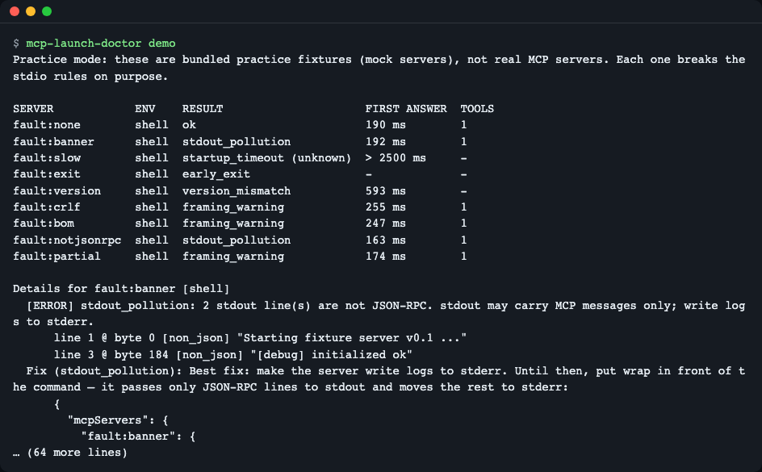
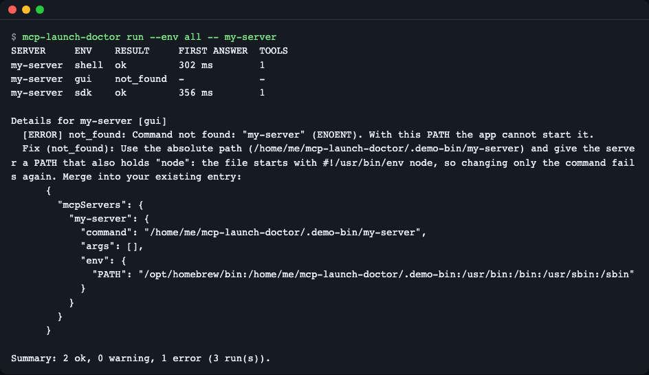
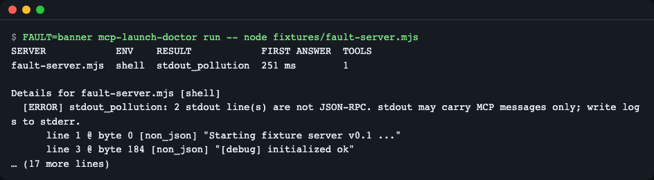
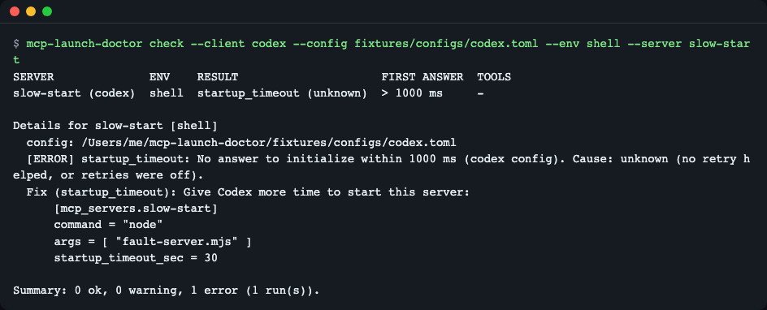
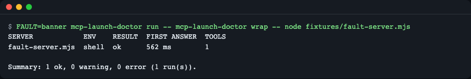
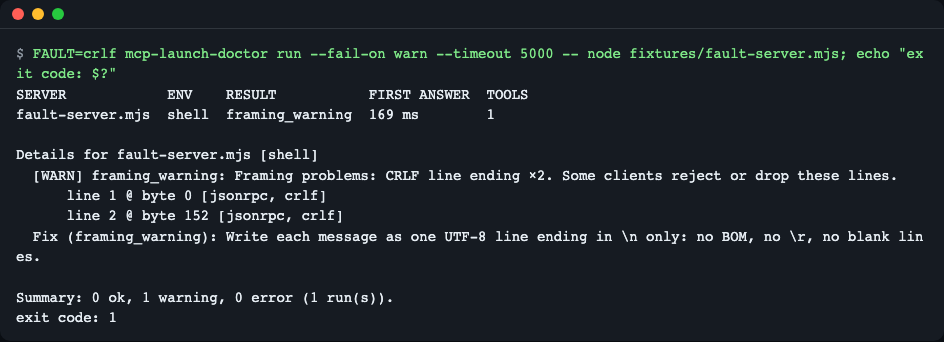
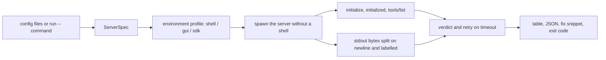

# mcp-launch-doctor

**English** | [한국어](README.ko.md)

Works in your terminal, but the app only says "Server disconnected"? `mcp-launch-doctor` starts a stdio MCP server the way Claude Desktop, Claude Code, Cursor, VS Code or Codex would, reads its stdout byte by byte, and tells you why it fails — with a config snippet you can paste back.


*`mcp-launch-doctor demo` launches nine bundled practice servers (mocks) and prints one verdict per server.*

## Who it is for

- You added an MCP server to an app and it only disconnects inside the app, never in your terminal.
- You write a stdio MCP server and want to know that nothing but JSON-RPC reaches stdout.
- You want a CI step that fails when a server prints a banner, starts too slowly, or uses CRLF/BOM line endings.

## Install

Requires Node.js 22 or newer (`node --version`). If you do not have it: install from <https://nodejs.org> or use [nvm](https://github.com/nvm-sh/nvm) (`nvm install 22`). On a minimal Linux image you also need `git` and `npm` (`apt-get install -y git npm` on Debian/Ubuntu).

```bash
# run without installing (once the package is on npm)
npx mcp-launch-doctor --help

# or from the repository
git clone https://github.com/LeeGyeongPil/mcp-launch-doctor
cd mcp-launch-doctor
npm ci          # installs dependencies and builds dist/
npm start       # builds, then runs the practice demo
```

In a clone, run `npm link` once if you want the short `mcp-launch-doctor` command on your PATH (or call `node dist/cli.js` directly). Inside a clone, `node dist/cli.js <command>` gives the same results as `npx mcp-launch-doctor <command>`, with one exception: the `wrap` fix snippet for `stdout_pollution`. Run through npx, the snippet starts wrap as `"command": "npx", "args": ["-y", "mcp-launch-doctor@0.2.0", "wrap", "--", …]` (pinned to the version you ran), because the npx cache folder can be deleted at any time. Run from a clone or a global install (`npm i -g mcp-launch-doctor`), it uses `node` and the absolute path of that `dist/cli.js`.

Examples and screenshots below use the short `mcp-launch-doctor` name, as after a global install. Each screenshot shows exactly the command in the code block above it.

## Safety note

`check` and `run` **start the commands written in your config**, exactly as the app would. Look first with `--dry-run` (it launches nothing), narrow down with `--server <name>`, and note that in an interactive terminal `check` lists the commands and asks once before launching (`--yes` skips the question; non-interactive runs such as CI do not ask). Secret-looking values (`*_KEY`, `*_TOKEN`, `*_SECRET`, `*PASSWORD*`, `sk-…`, `Bearer …`) are masked as `***` in every report, including command arguments (`--api-key sk-…`, `--token …`) and fix snippets; where a snippet shows `***`, keep your existing value.

## Quick start

```bash
mcp-launch-doctor demo
```

This is **practice mode**: the servers come from `fixtures/` in this repository. They are mock servers, not real MCP servers, but they are real child processes — one really prints a banner, one really answers late, one really exits with code 3. The tool judges them through the same code path it uses for your own servers. (A real run against your servers can be slower, for example when `npx` has to download a package on first use.)

The first lines of the output:

```
Practice mode: these are bundled practice fixtures (mock servers), not real MCP servers. Each one breaks the stdio rules on purpose.

SERVER            ENV    RESULT                     FIRST ANSWER  TOOLS
fault:none        shell  ok                         105 ms        1
fault:banner      shell  stdout_pollution           110 ms        1
fault:slow        shell  startup_timeout (unknown)  > 2500 ms     -
fault:exit        shell  early_exit                 -             -
fault:version     shell  version_mismatch           120 ms        -
fault:crlf        shell  framing_warning            113 ms        1
fault:bom         shell  framing_warning            110 ms        1
fault:notjsonrpc  shell  stdout_pollution           110 ms        1
fault:partial     shell  framing_warning            115 ms        1
```

(The milliseconds differ on every run.) Then diagnose your own apps' servers:

```bash
mcp-launch-doctor check                 # every client config it can find
mcp-launch-doctor check --client codex  # one client
mcp-launch-doctor run -- node dist/index.js   # a single command, no config file
```

## Usage

| Command | What it does |
|---|---|
| `check [options]` | Reads the config files of Claude Desktop, Claude Code, Cursor, VS Code and Codex and diagnoses each stdio server (defaults to the `gui` and `shell` environments). |
| `run [options] -- <command> [args…]` | Diagnoses one server command (defaults to `shell`). Handy in CI. |
| `wrap -- <command> [args…]` | Runs a server with only JSON-RPC lines passed to stdout; everything else goes to stderr. |
| `demo` | Practice run against the bundled mock servers. |

| Option | Meaning |
|---|---|
| `--client <name>` | `claude-desktop`, `claude-code`, `cursor`, `vscode`, `codex` or `all`. With `run`, picks the limits and the snippet format of that client. |
| `--config <path>` | Read this file instead of the default locations (`.toml` means Codex). |
| `--server <name>` | Only this server. |
| `--env <profiles>` | `shell`, `gui`, `sdk` (comma separated) or `all`. |
| `--timeout <ms>` | Startup limit for every server; overrides the client limits. |
| `--no-retry` | Do not retry a timeout to find its cause. |
| `--dry-run` | Show what would be launched; launch nothing. |
| `--yes` | Do not ask before launching (`check`). |
| `--json` | Machine-readable output (`schemaVersion: 1`). |
| `--fail-on <level>` | `error` (default), `warn` or `never`. |
| `--lang <lang>` | `en` or `ko`. |

Exit codes: `0` passed, `1` findings at or above `--fail-on`, `2` usage or config error.

### Scenario 1 — fine in the terminal, broken in the app

```bash
mcp-launch-doctor run --env all -- my-server
```


*The same server under three environments. Here `my-server` sits in a folder that only the shell PATH contains. The screenshot uses placeholder home paths; yours will show your own. To follow along from a clone, use the fixtures in `fixtures/` instead of `my-server`, for example `-- node fixtures/fault-server.mjs`.*

`shell` and `sdk` pass, `gui` fails with `not_found`: apps launched from the Dock or a menu do not get your shell profile, so their PATH is short. The fix snippet uses an absolute path **and** adds the folder of the interpreter to `env.PATH`. Changing only `command` is not enough when the file starts with `#!/usr/bin/env node`: the app would then fail again with `env: node: No such file or directory`. A snippet from `run` turns relative file arguments (relative to the current folder) and a relative `command` path into absolute paths, so it works however the app is started. The `wrap` snippet (scenario 4) does not add a `PATH` entry for the interpreter; see Known issues in [CHANGELOG.md](CHANGELOG.md).

### Scenario 2 — something prints on stdout

```bash
FAULT=banner mcp-launch-doctor run -- node fixtures/fault-server.mjs
```


*Line 1 starts at byte 0 and line 3 at byte 184; both are not JSON-RPC.*

The stdio transport allows only MCP messages on stdout. Logs belong on stderr. The report names the line, its byte offset and a preview, so you can find the `print` or `console.log` that does it.

### Scenario 3 — Codex gives up too early

```bash
mcp-launch-doctor check --client codex --config fixtures/configs/codex.toml --env shell --server slow-start
```


*`slow-start` needs 2 s but its config allows 1 s (`startup_timeout_sec = 1`).*

The tool applies the client's own limit (Codex: the server's `startup_timeout_sec`, otherwise 10 s). When a server times out it retries once to find the cause: the same command again (a fast second start means `first_run_install`, a package download on first use) and, for Python commands, with `PYTHONUNBUFFERED=1` (a fix means `buffering`). The fix comes in the client's own format — TOML for Codex, JSON for the others.

### Scenario 4 — put `wrap` in front

```bash
FAULT=banner mcp-launch-doctor run -- mcp-launch-doctor wrap -- node fixtures/fault-server.mjs
```


*Behind `wrap` the same banner server passes. The table still names the real server, `fault-server.mjs`: the tool looks through `wrap` to the command behind it.*

`wrap` moved the two banner lines to stderr (as `[wrap] diverted: Starting fixture server v0.1 ...` and `[wrap] diverted: [debug] initialized ok`), so only JSON-RPC reached stdout.

`wrap` is a stop-gap for servers you cannot fix yet. It passes JSON-RPC lines through (dropping a BOM, turning CRLF into LF), moves everything else to stderr, and forwards the exit code and stdin EOF. The best fix is still to make the server log to stderr. For a `stdout_pollution` result the tool prints the `wrap` config snippet for you.

### Scenario 5 — CI for server authors

```bash
FAULT=crlf mcp-launch-doctor run --fail-on warn --timeout 5000 -- node fixtures/fault-server.mjs; echo "exit code: $?"
```


*With `--fail-on warn`, warnings such as CRLF line endings also fail the step.*

Here the bundled practice server ends its lines with CRLF (`FAULT=crlf`). In your own CI step, put your server's command after `--`, for example `mcp-launch-doctor run --fail-on warn -- node dist/index.js`; a non-zero exit code fails the step.

Use `--json` for a stable report (`schemaVersion: 1`; keys and the `kind`, `severity`, `cause` values are always English, only `message`, `note` and `notice` are translated).

## What it detects

| Verdict | Level | Usual cause |
|---|---|---|
| `not_found` | error | command not on that environment's PATH |
| `interpreter_missing` | error | script found, its `#!/usr/bin/env X` interpreter not on PATH |
| `early_exit` | error | server exited before the handshake (stderr tail is shown) |
| `startup_timeout` | error | no answer to `initialize` in time; `cause`: `buffering`, `first_run_install` or `unknown` |
| `protocol_error` | error | wrong response id, `error` response, `tools/list` failure |
| `version_mismatch` | error | server answers a protocol version clients do not accept |
| `stdout_pollution` | error | non-JSON or non-JSON-RPC lines on stdout |
| `framing_warning` | warning | BOM, CRLF, blank line, invalid UTF-8, last line without newline |
| `unresolved_variable` | warning | `${…}` could not be expanded; the server is not launched |
| `npx_prompt_risk` | warning | `npx` without `-y`/`--yes` can wait for a prompt |
| `slow_start` | warning | first answer slower than half of the limit |
| `ok` | ok | handshake and `tools/list` succeeded |

`results[].verdict` is the main verdict; `findings[]` in `--json` lists all of them.

## Environment profiles

| Profile | What it imitates |
|---|---|
| `shell` | Your current environment. |
| `gui` | An app started from the desktop: macOS `PATH=/usr/bin:/bin:/usr/sbin:/sbin`, Linux the systemd default PATH, plus `HOME`, `USER`, `LOGNAME`, `SHELL`, `TMPDIR`. |
| `sdk` | The variables the official MCP SDK passes on by default (`HOME`, `LOGNAME`, `PATH`, `SHELL`, `TERM`, `USER`). |

These are **approximations**: apps and versions differ, so a `gui` pass or fail is strong evidence, not a guarantee. The `env` of the server entry is always applied last; Codex `env_vars` are handed on from your shell. On Windows only `shell` runs; `gui` and `sdk` are reported as `unsupported`.

## Config files and timeouts

| Client | Config read | Startup limit used |
|---|---|---|
| Claude Desktop | `claude_desktop_config.json` (`mcpServers`) | none documented, tool default 30 s |
| Claude Code | `./.mcp.json`, `~/.claude.json` (`mcpServers`, per-project) | `MCP_TIMEOUT` when set ([docs](https://code.claude.com/docs/en/mcp)), else 30 s |
| Cursor | `~/.cursor/mcp.json`, `./.cursor/mcp.json` | none documented, tool default 30 s |
| VS Code | `./.vscode/mcp.json`, user-profile `mcp.json` (macOS `~/Library/Application Support/Code/User/`, Linux `~/.config/Code/User/`, Windows `%APPDATA%\Code\User\`) (`servers`) | none documented, tool default 30 s |
| Codex | `$CODEX_HOME/config.toml` or `~/.codex/config.toml` (`[mcp_servers.<name>]`) | `startup_timeout_sec`, default 10 s ([docs](https://learn.chatgpt.com/docs/extend/mcp?surface=cli)) |

Variables: `${VAR}` and `${VAR:-default}` are expanded; `${workspaceFolder}` becomes the current folder; `${input:…}` and unset variables trigger `unresolved_variable` instead of launching with a wrong value. `url`/HTTP entries are listed as skipped. The VS Code user-profile `mcp.json` is read, so a `check` without arguments now also launches your global VS Code servers (interactive runs still ask before launching; in CI the number of result lines can grow, so pin it with `--client` or `--config`). In the user-profile `mcp.json`, `${workspaceFolder}` also becomes the folder you ran the command in. Not read yet: a custom `XDG_CONFIG_HOME` on Linux, VS Code Insiders, VSCodium, named extra profiles, remote and devcontainer settings, an `mcp` entry inside `settings.json`, and Windows paths for clients other than Claude Desktop and VS Code.

## Language

Output is English or Korean: `--lang en|ko` beats `MCP_LAUNCH_DOCTOR_LANG`, which beats `LC_ALL`, `LC_MESSAGES`, `LANG` (a value starting with `ko` means Korean; anything else English).

```bash
MCP_LAUNCH_DOCTOR_LANG=ko mcp-launch-doctor demo
```

The screenshots in this README were taken in a terminal with `LANG=en_US.UTF-8`; the Korean README shows the same commands run with `LANG=ko_KR.UTF-8`.

## How it works



1. Each config file is normalized into one server description (command, args, env, limits).
2. A profile builds the environment the server will see.
3. The server is started without a shell, in its own process group; stdin stays open.
4. The tool speaks the handshake itself and keeps the raw stdout bytes.
5. Stdout is cut at `\n` independent of chunk boundaries and every line is labelled: `jsonrpc`, `json_not_jsonrpc`, `non_json`, `blank`, plus `bom`, `crlf`, `invalid_utf8`, `partial_line`.
6. The verdict (and retry on timeout) turns that into one reason and a fix snippet in the client's format. The server and its child processes are always cleaned up.

## Why not just use the SDK or the Inspector?

The official SDK client reports a non-JSON stdout line only through `onerror` and keeps the connection open, so a server that prints a banner still looks healthy to an SDK-based check, while real apps may disconnect. This tool reads the bytes itself. Details and a way to reproduce it: [docs/why-not-sdk.md](docs/why-not-sdk.md).

## When to use it

- Good fit: an stdio server that works in your terminal but not in an app; guarding a server repository against stdout pollution and slow starts in CI.
- Other tools: browsing tools and calling them interactively → [MCP Inspector](https://github.com/modelcontextprotocol/inspector); remote (HTTP/SSE) servers are out of scope here. This tool does not call tools, audit security or edit your config files.

## Limitations

- macOS and Linux are verified; on Windows only the `shell` profile runs.
- The `gui` and `sdk` profiles approximate apps; behaviour changes between app versions.
- Piping the demo into something that closes early (for example `npm start | head -1`) can print an `EPIPE` stack trace. The output before it is intact.
- No automatic config editing; fixes are printed for you to merge into the existing entry.

## Troubleshooting

| Symptom | Cause | Fix |
|---|---|---|
| `check` finds no servers | The config is in a place the tool does not read, or reading was denied (it prints a `skipped …` warning) | Pass `--config <path> --client <name>` |
| `gui` says `not_found`, `shell` is ok | The app's PATH is short | Use the printed absolute path and `env.PATH` |
| `startup_timeout (unknown)` | The server really is slow | Raise the client limit or move slow setup after the handshake; try `--timeout 60000` |
| Exit code `2` | Unknown option or unreadable `--config` file | Read the message; compare with `--help` |
| `npm start` prints two extra lines first | npm prints its own script banner | `npm start --silent` |

## Development

```bash
npm ci
npm test        # builds, then runs the whole test suite (about 2 minutes; some tests wait on slow mock servers)
```

Requires Node.js 22+; the only runtime dependency is `smol-toml` 1.9.1. Bugs and ideas are welcome as issues. Changes are listed in [CHANGELOG.md](CHANGELOG.md).

## References

- MCP transports, stdio: <https://modelcontextprotocol.io/specification/2025-11-25/basic/transports> (checked 2026-11-13)
- Claude Code MCP docs: <https://code.claude.com/docs/en/mcp> (checked 2026-11-13)
- VS Code MCP configuration: <https://code.visualstudio.com/docs/copilot/reference/mcp-configuration> (checked 2026-11-13)
- Codex MCP configuration: <https://learn.chatgpt.com/docs/extend/mcp?surface=cli> (checked 2026-11-13)

## License

MIT. Bundled fixtures and sample configs were written for this repository.
